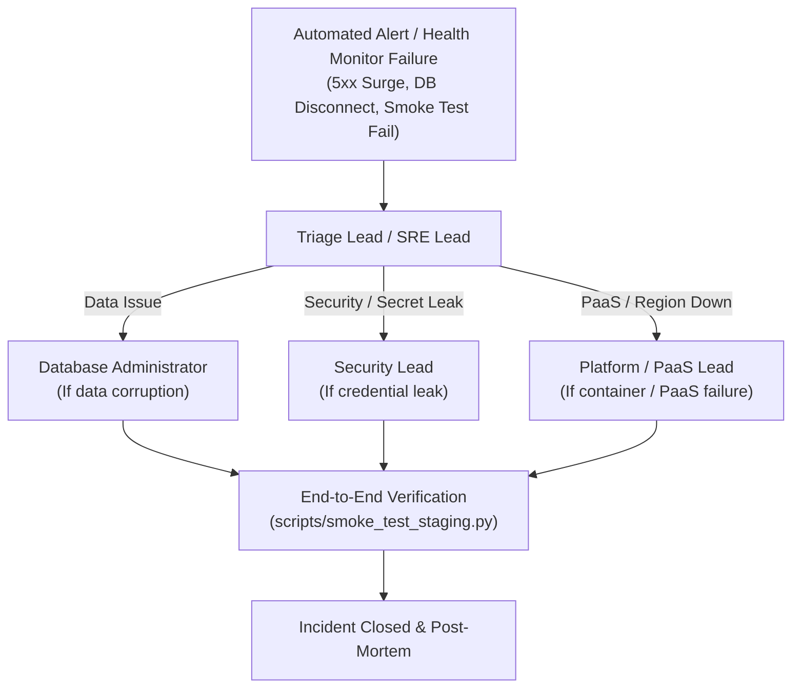

# 🚨 PR AI WORKFORCE — Disaster Recovery (DR) Runbook

This document defines disaster recovery targets, escalation procedures, and concrete restoration steps for catastrophic infrastructure, database, security, and cloud service failures.

---

## 🎯 1. Service Level Objectives (SLOs) & Targets

| Metric | Target SLA | Explanation |
|:---|:---:|:---|
| **RTO (Recovery Time Objective)** | **`< 30 Minutes`** | Maximum acceptable duration to restore fully operational platform status after an incident. |
| **RPO (Recovery Point Objective)** | **`< 24 Hours`** | Maximum acceptable data loss window (backed up daily at 02:00 AM UTC). |
| **Integrity SLA** | **100% SHA256 Verified** | All restored database archives must match cryptographic checksum before restoration. |

---

## 📋 2. Incident Escalation & Response Roles



---

## 🛠️ 3. Failure Scenarios & Restoration Runbooks

### Scenario 1: DB Corruption (Database Restore Steps)

**Symptoms:** Table dropped, database corrupted, or unrecoverable bad data mutation.

#### Step 1: Retrieve Latest Verified Backup
1. Navigate to the GitHub repository: **Actions** → **Supabase Database Backup & Integrity Verification**.
2. Select the latest successful run and download the `supabase-database-backup-<run_id>` artifact.
   *(Or locate the latest backup in local `backups/` directory).*
3. Extract the `db_<TIMESTAMP>.dump.gz` file and the corresponding `.sha256` file.

#### Step 2: Verify Cryptographic Integrity
```bash
# Verify checksum matches exactly
sha256sum -c db_<TIMESTAMP>.dump.gz.sha256
# Expected output: db_<TIMESTAMP>.dump.gz: OK
```
> ⚠️ **DO NOT ATTEMPT RESTORATION** if the checksum verification fails. Retrieve the previous day's backup.

#### Step 3: Execute Restoration
- **Using Native `pg_restore`:**
  ```bash
  export PGPASSWORD="<SUPABASE_DB_PASSWORD>"
  pg_restore -h aws-0-eu-west-1.pooler.supabase.com \
             -p 5432 \
             -U postgres.qqmfwkvwrsogveqwfuem \
             -d postgres \
             --clean \
             --if-exists \
             --no-owner \
             --no-privileges \
             backups/db_<TIMESTAMP>.dump.gz
  ```

#### Step 4: Run Post-Restoration Verifications
```bash
# 1. Verify schema migrations
python -c "from apps.api.database import engine; from sqlalchemy import text; conn=engine.connect(); print('Migrations count:', conn.execute(text('SELECT count(*) FROM schema_migrations')).scalar()); conn.close()"

# 2. Run automated smoke tests
python scripts/smoke_test_staging.py --base-url http://127.0.0.1:8000
```

---

### Scenario 2: Secrets Leaked (Emergency Rotation Protocol)

**Symptoms:** Credentials detected in public commit, unauthorized login spikes, or token exposure.

Follow the complete rotation guide in [docs/ROTATION_GUIDE.md](ROTATION_GUIDE.md).

#### Step 1: Immediate Containment
1. In Supabase Dashboard: Reset database password immediately (**Project Settings** → **Database** → **Database Password** → **Reset password**).
2. In Upstash Console: Rotate REST API / Redis Token (**Database** → **Details** → **Rotate Token**).

#### Step 2: Generate Fresh Application Keys
```bash
python scripts/generate_secrets.py --output-file NEW_SECRETS.txt
```

#### Step 3: Validate Fresh Credentials Live
```bash
# Update NEW_SECRETS.txt with the new DB and Redis URLs, then run:
python scripts/verify_rotation.py
```

#### Step 4: Apply & Deploy
```bash
python scripts/apply_rotation.py
```
Update environment variables in the Railway console and trigger a deployment. Verify with `scripts/smoke_test_staging.py`.

---

### Scenario 3: Redis Down (Fail-Open Behavior & Fallback)

**Symptoms:** `/health/redis` returns non-200, Upstash connection timeout.

#### Fail-Open System Behavior:
1. **Rate Limiting:** The FastAPI `RateLimitMiddleware` automatically fails-open and falls back gracefully to in-memory sliding window cache (`_MEMORY_RATE_LIMITS`) so that legitimate user traffic is **never blocked** during a Redis outage.
2. **Read Caches:** Data queries on `/api/agents` and `/api/dashboard/stats` bypass the cache layer and fetch directly from Supabase PostgreSQL, ensuring continuous service operation.

#### Recovery & Restoration:
1. Check Upstash status at [status.upstash.com](https://status.upstash.com).
2. If temporary regional outage in `eu-west-1`: Fail-open behavior handles traffic seamlessly until Upstash recovers.
3. If persistent failure (> 15 minutes):
   - Provision backup Redis instance on Upstash in secondary European region (`europe-west4`).
   - Update `REDIS_URL` in Railway environment variables and redeploy API service.

---

### Scenario 4: Cloud PaaS (Railway) Region Outage

**Symptoms:** Railway gateway unreachable, 502/503 Cloudflare gateway timeouts.

#### Emergency Action:
1. Verify Railway status at [status.railway.app](https://status.railway.app).
2. If primary region (`eu-west-1`) is degraded:
   - Change Service region in Railway to `europe-west4` (Amsterdam/Netherlands) and trigger re-deploy.
3. If entire Railway PaaS is offline:
   - Dockerfiles are 100% portable OCI containers (`Dockerfile.api` and `Dockerfile.web`).
   - Deploy directly to Render, Fly.io, or AWS ECS by pointing to the repository and specifying `Dockerfile.api` and `Dockerfile.web`.
   - Update DNS records in Cloudflare to route traffic to the secondary runner.

---

## 🔒 4. Post-Incident Review & Compliance

After any incident resolution:
1. Conduct post-mortem review within 24 hours.
2. Verify all temporary credentials used during incident response have been terminated.
3. Confirm automated backup integrity (`scripts/backup_supabase.py`).
4. Update this runbook with newly discovered failure patterns.
